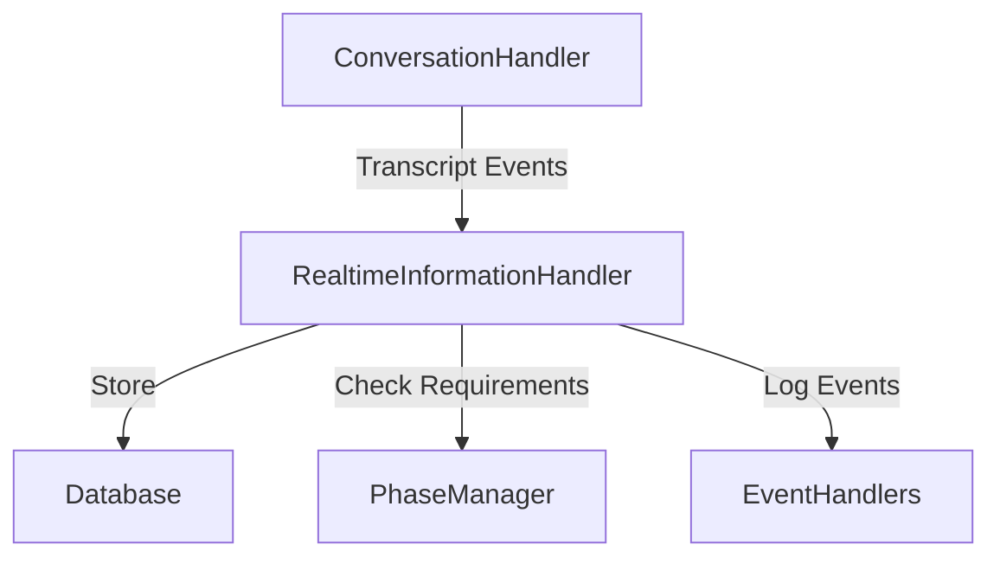

# SF002.2.3: Realtime Information Extraction

## Overview
This subfeature enables real-time identification, extraction, and processing of structured data from candidate responses using the OpenAI realtime API's transcript events. It analyzes candidate responses in real-time without disrupting the conversation flow.

## Status
**Status**: Partially Implemented
**Last Updated**: [Current Date]

## How It Fits Into the Greater System
The Realtime Information Extraction component works in conjunction with:

1. **Phase Definition System (SF002.2.1)**
   - Receives phase-specific information requirements
   - Uses requirements to guide extraction priorities
   - Signals phase completion when requirements are met

2. **Conversation Event Handlers (SF002.2.2)**
   - Integrates as a registered event handler
   - Processes transcript events from the realtime API
   - Coordinates with other handlers for logging and persistence
   - Participates in error recovery and timing management

## Detailed Requirements

### Component Structure


### Event Handler Implementation
The `RealtimeInformationHandler` implements the common event handler interface:

```go
type RealtimeInformationHandler struct {
    phaseManager    *phase.Manager
    extractedData   map[string]ExtractedInfo
    db             *sql.DB
    logger         *log.Logger
    transcriptBuffer []string
    transcriptMu    sync.Mutex
    extractionQueue chan string
    done           chan struct{}
}

func (h *RealtimeInformationHandler) HandleEvent(ctx context.Context, event Event) error {
    switch e := event.(type) {
    case *ResponseAudioTranscriptDelta:
        return h.bufferTranscriptDelta(e.Text)
    case *ResponseAudioTranscriptDone:
        return h.processCompleteTranscript()
    }
    return nil
}
```

### Real-Time Information Extraction
1. Implement asynchronous extraction mechanisms:
   - Process candidate responses from OpenAI realtime API stream
   - Extract structured data without blocking conversation flow
   - Maintain extraction context across conversation turns
   - Update extraction results as new information is discovered
2. Develop confidence scoring for extracted information
3. Track extraction status per required information field
4. Provide mechanisms to request clarification when information is ambiguous

### Realtime Stream Processing
1. Implement stream handlers for OpenAI realtime API:
   ```go
   type RealtimeStreamHandler struct {
       client         *openairt.Client
       conn           *openairt.Conn
       extractor      *InformationExtractor
       phaseManager   *PhaseManager
   }

   func (h *RealtimeStreamHandler) HandleStream(ctx context.Context) error {
       for {
           msg, err := h.conn.ReadMessage(ctx)
           if err != nil {
               return fmt.Errorf("stream read error: %w", err)
           }

           // Process message based on type
           switch msg.ServerEventType() {
           case openairt.ServerEventTypeResponseTextDelta:
               // Handle incremental text response
               textDelta := msg.(openairt.ResponseTextDeltaEvent)
               h.processTextDelta(ctx, textDelta)

           case openairt.ServerEventTypeResponseVoiceDelta:
               // Handle voice stream chunk
               voiceDelta := msg.(openairt.ResponseVoiceDeltaEvent)
               h.processVoiceDelta(ctx, voiceDelta)

           case openairt.ServerEventTypeTranscript:
               // Process transcript for information extraction
               transcript := msg.(openairt.TranscriptEvent)
               go h.extractor.ExtractFromTranscript(ctx, transcript)
           }
       }
   }
   ```

2. Implement incremental information extraction:
   - Process transcript chunks as they arrive
   - Update extraction state with partial information
   - Merge and deduplicate information across chunks
   - Handle corrections and updates in transcription

3. Define stream processing configuration:
   ```json
   {
     "stream_config": {
       "chunk_size": 1024,
       "processing_interval": "100ms",
       "buffer_size": 8192,
       "extraction_batch_size": 5
     },
     "extraction_rules": {
       "minimum_confidence": 0.8,
       "merge_strategy": "most_recent",
       "deduplication_window": "5s"
     }
   }
   ```

4. Implement error handling for stream processing:
   - Handle connection interruptions
   - Manage buffer overflows
   - Process partial or corrupted chunks
   - Recover from stream desynchronization

### Data Structure Definition
1. Define schema for extractable information types:
   - Candidate skills (name, proficiency, years of experience)
   - Work experience (company, role, duration, responsibilities)
   - Education (degree, institution, graduation date)
   - Preferences (location, role type, company size, compensation)
   - Availability (start date, notice period, interview availability)
2. Support extraction of both explicit and implied information
3. Enable relationships between extracted data points
4. Implement validation rules for extracted information
5. Support normalization of extracted entities to standard forms

### Extraction Context Management
1. Maintain context across conversation turns:
   - Track previously extracted information
   - Identify contradictions in new information
   - Resolve conflicts between information sources
   - Maintain extraction history for auditing
2. Integrate with phase management:
   - Define phase-specific extraction priorities
   - Track completion status of required information
   - Signal phase transitions when information is complete
3. Support conversation steering based on missing information

### LLM Prompt Engineering
1. Design targeted extraction prompts for different information types
2. Create hierarchical extraction for complex information structures
3. Implement context-aware extraction based on conversation history
4. Develop specialized extraction techniques for ambiguous information
5. Support both zero-shot and few-shot extraction patterns

## User Experience
1. No interruption to natural conversation flow due to asynchronous processing
2. System appears knowledgeable about already-discussed information
3. Natural follow-up questions for incomplete or ambiguous information
4. Smooth integration of extracted information into conversation flow

## Test Cases
1. **Basic Extraction**: Verify system extracts clear statements about skills and experience
2. **Ambiguity Handling**: Verify system correctly handles ambiguous or implicit information
3. **Context Preservation**: Verify extraction maintains context across multiple conversation turns
4. **Contradiction Detection**: Verify system identifies and resolves contradictions in extracted information
5. **Normalization**: Verify extracted entities are properly normalized to standard forms
6. **Asynchronous Performance**: Verify extraction process doesn't cause noticeable delays in conversation

## Implementation References
The implementation can leverage parts of the information extraction logic already being developed for SF002.3:

```go
// Similar to extraction logic in SF002.3, but adapted for real-time processing
func extractInformationAsync(ctx context.Context, message string, extractionConfig *ExtractionConfig) {
    go func() {
        extractedInfo, err := performExtraction(ctx, message, extractionConfig)
        if err != nil {
            log.Printf("Error in async extraction: %v", err)
            return
        }
        
        // Store extracted information
        storeExtractedInformation(ctx, extractedInfo)
        
        // Signal information availability
        notifyInformationAvailable(extractedInfo)
    }()
}
```

## Database Schema
New tables to support real-time information extraction:

```sql
CREATE TABLE IF NOT EXISTS extraction_configs (
    id TEXT PRIMARY KEY,
    phase_id TEXT NOT NULL,
    config_json TEXT NOT NULL,
    created_at TIMESTAMP DEFAULT CURRENT_TIMESTAMP,
    updated_at TIMESTAMP
);

CREATE TABLE IF NOT EXISTS realtime_extracted_information (
    id SERIAL PRIMARY KEY,
    conversation_id TEXT NOT NULL,
    message_id INTEGER,
    field_key TEXT NOT NULL,
    field_value TEXT NOT NULL,
    data_type TEXT NOT NULL,
    confidence FLOAT NOT NULL,
    is_confirmed BOOLEAN DEFAULT false,
    extracted_at TIMESTAMP NOT NULL,
    FOREIGN KEY (conversation_id) REFERENCES conversations(id),
    FOREIGN KEY (message_id) REFERENCES messages(id)
);

CREATE TABLE IF NOT EXISTS extraction_events (
    id SERIAL PRIMARY KEY,
    conversation_id TEXT NOT NULL,
    event_type TEXT NOT NULL,
    event_data TEXT NOT NULL,
    created_at TIMESTAMP NOT NULL,
    FOREIGN KEY (conversation_id) REFERENCES conversations(id)
);
```

## Dependencies
- OpenAI realtime API integration
- go-openai-realtime library
- Secondary LLM for information extraction
- Asynchronous processing framework
- Database access for storing extracted information
- Entity normalization utilities
- Context management system

## Implementation Guidance

### System Overview

The Realtime Information Extraction component is responsible for analyzing candidate responses in real-time during the conversation to extract structured data without disrupting the natural flow of the dialogue. This differs from post-call processing (handled by SF002.3) by focusing on immediate extraction during the conversation to inform the ongoing dialogue.

Key aspects of this system include:

1. **Asynchronous Processing**: Extracts information without blocking or delaying the conversation flow
2. **Real-Time Analysis**: Processes each candidate response as it occurs
3. **Structured Data Extraction**: Converts natural language responses into structured, machine-readable data
4. **Confidence Scoring**: Assigns confidence levels to extracted information
5. **Context-Aware Processing**: Maintains context across multiple conversation turns
6. **Normalization**: Standardizes extracted entities to canonical forms

### How It Works

The information extraction process follows these steps:

1. **Message Interception**: When a candidate responds, the middleware intercepts the message
2. **Asynchronous Processing**: The message is sent for extraction in a separate thread that doesn't block conversation
3. **LLM-Based Extraction**: A specialized LLM prompt extracts structured information from the response:
   ```
   Candidate: "I've been working with Python for about 5 years, mostly in finance applications"
   Extracted: { "skills": [{"name": "Python", "years": 5, "domain": "finance"}] }
   ```
4. **Storage and Indexing**: Extracted information is stored both in-memory (for immediate use) and in the database (for persistence)
5. **Context Enrichment**: The conversation context is enriched with extracted information for the LLM's next response
6. **Feedback Loop**: Extraction results inform the conversation middleware about:
   - Which required information has been collected
   - What information is still missing
   - What information needs clarification

This process happens continuously throughout the conversation, building a progressively more complete profile of the candidate.

### How It Fits Into the Greater System

The Realtime Information Extraction component serves as a critical link in the Structured Conversation feature:

1. **Integration with Phase Definition System (SF002.2.1)**: The phase configuration defines what information should be extracted in each phase. The extraction component uses the `required_information` fields from the phase definition to know what data to look for.

2. **Support for Middleware Framework (SF002.2.2)**: Implements as a handler component that processes realtime events, allowing it to process transcripts without disrupting the conversation flow.

3. **Enablement of Error Recovery (SF002.2.4)**: Provides feedback to the error recovery system about missing or ambiguous information that might require follow-up questions.

4. **Coordination with Time Management (SF002.2.5)**: Works with the time management system to prioritize extraction of critical information when time is limited.

5. **Relationship to SF002.3 (Post-Call Information Extraction)**: While this component focuses on real-time extraction during the conversation, SF002.3 performs more comprehensive analysis after the call concludes:
   - SF002.2.3: Quick, focused extraction for conversation guidance (real-time)
   - SF002.3: Thorough, detailed extraction for profile building (post-call)

The component fits into the data flow as follows:

```
┌─────────────────────────────────────────────────────┐
│                  Conversation Flow                   │
└───────────────────────────┬─────────────────────────┘
                           │
                           ▼
┌─────────────────────────────────────────────────────┐
│            Conversation Middleware Chain             │
└───────────────────────────┬─────────────────────────┘
                           │
                           ▼
┌─────────────────────────────────────────────────────┐
│         Realtime Information Extraction Handler     │
│                                                     │
│  ┌─────────────┐      ┌───────────────────────┐    │
│  │  Transcript │─────▶│ Asynchronous         │    │
│  │  Processing │      │ Extraction Process    │    │
│  └─────────────┘      └───────────┬───────────┘    │
│                                  │                 │
│  ┌─────────────┐      ┌───────────▼───────────┐    │
│  │  Context    │◀─────│ Extracted Information │    │
│  │ Enrichment  │      │ Storage & Management  │    │
│  └─────────────┘      └───────────────────────┘    │
│                                                     │
└────────────────────────┬────────────────────────────┘
                         │
                         ▼
┌─────────────────────────────────────────────────────┐
│            Database Storage & Integration            │
└─────────────────────────────────────────────────────┘
```

The extracted information serves multiple purposes:
1. Helps guide the conversation toward gathering missing information
2. Signals phase transitions when required information is collected
3. Builds a progressive profile of the candidate during the conversation
4. Serves as input for the more comprehensive post-call analysis
5. Enables immediate feedback for the candidate during the conversation

This real-time extraction capability is essential for creating adaptive, intelligent conversations that efficiently gather necessary information while maintaining a natural, conversational tone.

## Usage Example

### Realtime Information Extraction Handler
```go
type RealtimeInformationHandler struct {
    extractionConfig   *ExtractionConfig
    extractionClient   LLMClient
    extractedData      *sync.Map
    db                 *sql.DB
    conversationID     string
}

func NewRealtimeInformationHandler(config *ExtractionConfig, db *sql.DB, conversationID string) *RealtimeInformationHandler {
    return &RealtimeInformationHandler{
        extractionConfig: config,
        db:              db,
        conversationID:  conversationID,
        extractedData:   &sync.Map{},
    }
}

func (h *RealtimeInformationHandler) HandleEvent(ctx context.Context, event openairt.ServerEvent) error {
    switch event.ServerEventType() {
    case openairt.ServerEventTypeResponseAudioTranscriptDelta:
        // Buffer transcript deltas (word by word)
        delta := event.(openairt.ResponseAudioTranscriptDeltaEvent)
        h.bufferTranscriptDelta(delta.Delta)
        
    case openairt.ServerEventTypeResponseAudioTranscriptDone:
        // Process complete transcript (end of utterance)
        h.processCompleteTranscript(ctx)
    }
    return nil
}

func (h *RealtimeInformationHandler) extractAndStoreInformation(ctx context.Context, transcript string) {
    // Create extraction prompt based on current phase and conversation history
    prompt := createExtractionPrompt(h.extractionConfig, transcript)
    
    // Call LLM for extraction
    extractionResult, err := h.extractionClient.Extract(ctx, prompt)
    if err != nil {
        log.Printf("Extraction error: %v", err)
        return
    }
    
    // Process extracted information
    for key, value := range extractionResult.Data {
        // Store in memory for immediate use
        h.extractedData.Store(key, value)
        
        // Store in database for persistence
        if err := h.storeExtractedField(ctx, key, value, extractionResult.Confidence[key]); err != nil {
            log.Printf("Error storing extracted field: %v", err)
        }
    }
    
    // Log extraction event
    h.logExtractionEvent(ctx, "extraction_complete", extractionResult)
}
```

### Extraction Prompt Example
```
# Information Extraction

## System Instructions
You are an AI assistant responsible for extracting structured information from a conversation between a recruiter and a job candidate. Extract only factual information stated by the candidate.

## Current Phase
{{current_phase}}

## Information to Extract
{{extraction_fields}}

## Conversation History
{{conversation_history}}

## Latest Message
{{latest_message}}

## Output Format
Return a JSON object with the following structure:
{
  "extracted_data": {
    "field_key1": "extracted_value1",
    "field_key2": "extracted_value2"
  },
  "confidence": {
    "field_key1": 0.95,
    "field_key2": 0.8
  },
  "missing_information": [
    "field_key3"
  ]
}
```

## Notes on Implementation
- Information extraction should be performed asynchronously to avoid blocking conversation flow
- Extraction should use a separate LLM call from the conversation generation
- Confidence scoring is essential for determining when to request clarification
- Consider caching extracted information to avoid redundant extraction
- Implement fallbacks for when extraction fails or returns low confidence results

# Developer Audit

## Compliance Review
- **Completeness**: The specification is comprehensive with all required sections including the detailed asynchronous extraction approach.
- **Consistency**: This sub-feature directly supports the main SF002.2 Structured Conversation feature's requirement for gathering candidate information during natural conversations.
- **Accuracy**: The implementation approach properly focuses on asynchronous processing to maintain natural conversation flow.
- **Status**: Correctly marked as "Not Implemented" with clear implementation guidance.

## Improvement Recommendations
1. **Integration Details**: More specific information on how this feature connects with SF002.3 (which is referenced) would improve implementation clarity.
2. **Database Integration**: While database schemas are provided, more details on query patterns and performance considerations would be helpful.
3. **Error Recovery**: Expand on how extraction errors should be handled to maintain conversation quality.
4. **Normalization Standards**: Add more specifics about entity normalization standards and techniques.

## Missing Elements
- No explicit performance benchmarks for extraction processing time
- Limited discussion of how extraction priorities adapt based on the 15-20 minute time constraint
- Missing specific guidance on data retention policies for extracted information
- No clear specification for how conflicting extracted information should be resolved

## Documentation Quality
The specification provides a strong foundation for implementing real-time information extraction with good code examples and database schema definitions. The asynchronous approach is well-described and aligns with the requirement to maintain natural conversation flow. The extraction prompt example is particularly valuable for implementation guidance. 

## InformationExtractionHandler manages the extraction of structured information
// from the conversation in real-time during phone calls
type InformationExtractionHandler struct {
    phaseManager   *PhaseManager
    extractedData  *sync.Map
    db            *sql.DB
    logger        *slog.Logger
    
    // Buffers for transcript processing
    transcriptBuffer   strings.Builder
    transcriptMu      sync.Mutex
    
    // Channels for async processing
    extractionQueue chan ExtractionTask
    done           chan struct{}
}

type ExtractionTask struct {
    Content        string
    Phase          string
    ConversationID string
    Timestamp      time.Time
}

func NewInformationExtractionHandler(db *sql.DB, logger *slog.Logger) *InformationExtractionHandler {
    return &InformationExtractionHandler{
        extractedData:    &sync.Map{},
        db:              db,
        logger:          logger,
        extractionQueue: make(chan ExtractionTask, 100),
        done:            make(chan struct{}),
    }
}

// HandleEvent processes OpenAI realtime events and extracts information
func (h *InformationExtractionHandler) HandleEvent(ctx context.Context, event openairt.ServerEvent) {
    switch event.ServerEventType() {
    case openairt.ServerEventTypeResponseAudioTranscriptDelta:
        // Buffer transcript deltas (word by word)
        delta := event.(openairt.ResponseAudioTranscriptDeltaEvent)
        h.bufferTranscriptDelta(delta.Delta)
        
    case openairt.ServerEventTypeResponseAudioTranscriptDone:
        // Process complete transcript (end of utterance)
        h.processCompleteTranscript(ctx)
    }
}

// bufferTranscriptDelta safely adds to the transcript buffer
func (h *InformationExtractionHandler) bufferTranscriptDelta(delta string) {
    h.transcriptMu.Lock()
    defer h.transcriptMu.Unlock()
    
    h.transcriptBuffer.WriteString(delta)
    h.logger.Debug("buffered transcript delta", 
        "delta", delta,
        "buffer_size", h.transcriptBuffer.Len())
}

// processCompleteTranscript handles a complete transcript turn
func (h *InformationExtractionHandler) processCompleteTranscript(ctx context.Context) {
    h.transcriptMu.Lock()
    transcript := h.transcriptBuffer.String()
    h.transcriptBuffer.Reset() // Clear the buffer for the next turn
    h.transcriptMu.Unlock()
    
    if transcript == "" {
        return // Nothing to process
    }
    
    h.logger.Debug("processing complete transcript", 
        "length", len(transcript))
    
    // Queue the complete transcript for extraction
    h.queueForExtraction(ExtractionTask{
        Content:   transcript,
        Timestamp: time.Now(),
    })
}

// ExtractedValue represents a piece of extracted information with metadata
type ExtractedValue struct {
    Value      interface{} `json:"value"`
    Confidence float64     `json:"confidence"`
    Timestamp  time.Time   `json:"timestamp"`
}

// extractAndStore performs the actual information extraction and storage
func (h *InformationExtractionHandler) extractAndStore(ctx context.Context, task ExtractionTask) error {
    // Skip extraction for very short content
    if len(task.Content) < 5 {
        return nil
    }

    // Extract information using LLM
    extractedInfo, err := h.extractInformation(ctx, task)
    if err != nil {
        return fmt.Errorf("extraction failed: %w", err)
    }

    // If no information was extracted, just return
    if len(extractedInfo) == 0 {
        return nil
    }

    // Store in memory for immediate use
    for key, value := range extractedInfo {
        existing, loaded := h.extractedData.LoadOrStore(key, value)
        if loaded {
            // If we already have this key, update it only if the new value has higher confidence
            if existingValue, ok := existing.(ExtractedValue); ok {
                newValue := value.(ExtractedValue)
                if newValue.Confidence > existingValue.Confidence {
                    h.extractedData.Store(key, value)
                }
            }
        }
    }

    // Store in database
    if err := h.persistExtractedInfo(ctx, extractedInfo, task); err != nil {
        return fmt.Errorf("persistence failed: %w", err)
    }

    return nil
}

// extractInformation uses an LLM to extract structured information from the transcript
func (h *InformationExtractionHandler) extractInformation(ctx context.Context, task ExtractionTask) (map[string]ExtractedValue, error) {
    // Create extraction prompt based on the transcript
    prompt := fmt.Sprintf(`Extract relevant information from the following transcript:
Transcript: %s

Focus on:
- Skills and experience (including years of experience)
- Work history (company names, roles, dates)
- Education (degrees, institutions, graduation dates)
- Preferences (location, role type, salary)
- Availability (start date, notice period)

Return only factual information that was explicitly stated.
Format as JSON with confidence scores (0.0 to 1.0) for each extracted piece of information.`, 
        task.Content)

    // TODO: Call LLM for extraction
    // This would use a separate LLM call optimized for structured extraction
    // The response should be parsed into the ExtractedValue format

    return nil, nil // Placeholder
}

// Database schema for storing extracted information
const createTableSQL = `
CREATE TABLE IF NOT EXISTS extracted_information (
    id SERIAL PRIMARY KEY,
    conversation_id TEXT NOT NULL,
    key TEXT NOT NULL,
    value JSONB NOT NULL,
    confidence FLOAT NOT NULL,
    transcript_reference TEXT NOT NULL,
    extracted_at TIMESTAMP NOT NULL,
    created_at TIMESTAMP DEFAULT CURRENT_TIMESTAMP,
    
    UNIQUE (conversation_id, key, transcript_reference)
);

CREATE INDEX IF NOT EXISTS idx_extracted_info_conversation 
ON extracted_information (conversation_id);
`

// persistExtractedInfo stores the extracted information in the database
func (h *InformationExtractionHandler) persistExtractedInfo(ctx context.Context, info map[string]ExtractedValue, task ExtractionTask) error {
    for key, value := range info {
        valueJSON, err := json.Marshal(value.Value)
        if err != nil {
            return fmt.Errorf("failed to marshal value: %w", err)
        }

        _, err = h.db.ExecContext(ctx, `
            INSERT INTO extracted_information 
                (conversation_id, key, value, confidence, transcript_reference, extracted_at)
            VALUES 
                ($1, $2, $3, $4, $5, $6)
            ON CONFLICT (conversation_id, key, transcript_reference) 
            DO UPDATE SET
                value = EXCLUDED.value,
                confidence = EXCLUDED.confidence,
                extracted_at = EXCLUDED.extracted_at
            WHERE EXCLUDED.confidence > extracted_information.confidence
        `, 
        task.ConversationID, key, valueJSON, value.Confidence, 
        task.Content, value.Timestamp)
        
        if err != nil {
            return fmt.Errorf("failed to persist extraction: %w", err)
        }
    }

    return nil
}

func NewConversationHandler(apiKey string, extractor *InformationExtractionHandler, logger *slog.Logger) (*ConversationHandler, error) {
    client := openairt.NewClient(apiKey)
    
    conn, err := client.Connect(context.Background(),
        openairt.WithModel("gpt-4o-realtime-preview"),
        openairt.WithLogger(openairt.StdLogger{}),
    )
    if err != nil {
        return nil, fmt.Errorf("failed to connect to OpenAI: %w", err)
    }

    // Configure the session for audio only
    err = conn.SendMessage(context.Background(), openairt.SessionUpdateEvent{
        Session: openairt.ClientSession{
            Instructions: getSystemInstructions(),
            Modalities: []openairt.Modality{
                openairt.ModalityAudio, // Audio only
            },
            InputAudioFormat: openairt.AudioFormatG711Ulaw,  // Standard phone audio format
            OutputAudioFormat: openairt.AudioFormatG711Ulaw,
            InputAudioTranscription: &openairt.InputAudioTranscription{
                Model: "whisper-1",
            },
        },
    })
    if err != nil {
        return nil, fmt.Errorf("failed to configure session: %w", err)
    }

    return &ConversationHandler{
        client:    client,
        conn:      conn,
        extractor: extractor,
        logger:    logger,
    }, nil
} 